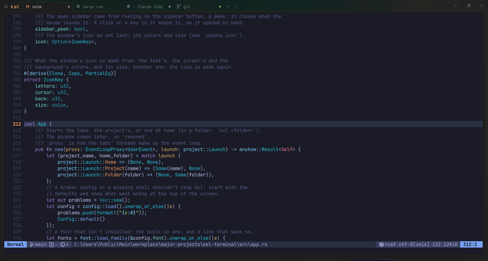
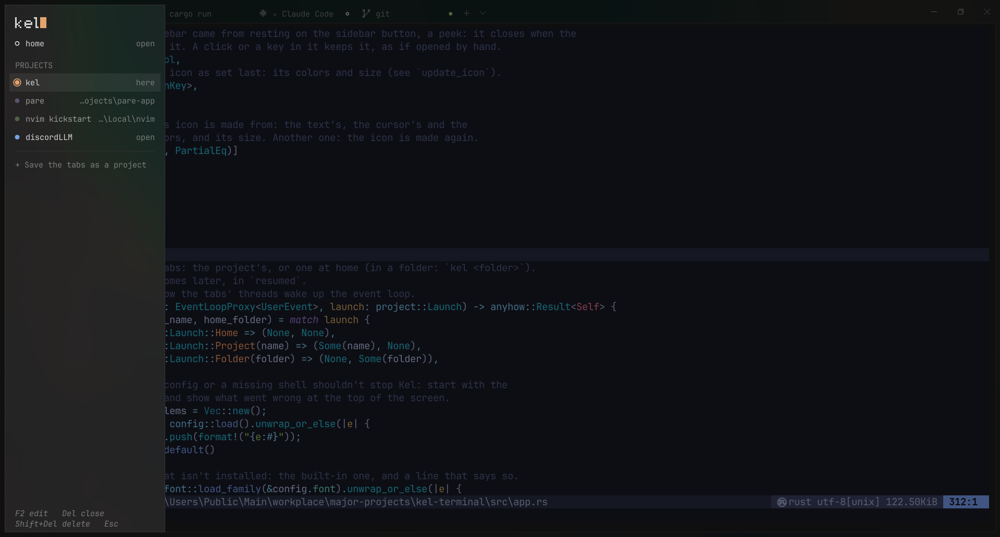
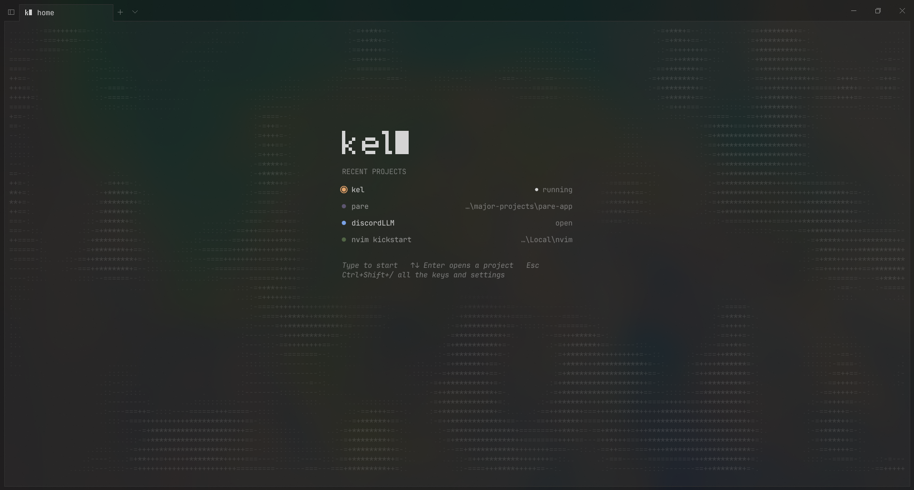

# Kel

A terminal for Windows, written in Rust, built to be a daily work tool: tabs, and
**projects**, saved sets of tabs that open a whole workspace in one go.



Kel runs on Windows 10 and 11. Linux and macOS are coming. See
[ROADMAP.md](ROADMAP.md) for what's done and what's next.

## What it does

- **Projects.** A project remembers its tabs: each one's name, folder and startup
  command (`nvim .` in one, `cargo run` in another). Open it and it's all there;
  close the window and it's saved as you left it. Several stay open at once, out of
  sight but running, and Ctrl+Alt+→ goes through them.
- **The sidebar** lists the projects, each in its color: which are open, where a
  command runs, where there's output you haven't seen.
- **Tabs that say what runs in them**: an icon for nvim, git, Claude Code, docker,
  ssh, a database; a ring while a command runs, a green or red dot when it ended
  while you were in another tab.
- **Home**: Kel without a project. Its start screen has the projects used last, over
  an ASCII landscape by day and stars at night.
- **Glass**: Windows' blur behind the window, with a fine grain. Under lazygit or
  Claude Code the background goes solid, so they read well.
- **Made for nvim and Claude Code**: any color, the mouse, pasting that doesn't run
  lines by itself, Nerd Font icons built in for any font, and the taskbar button
  blinking when Claude Code rings.
- **One file**, about 6 MB, with its font in it. No installer, no admin rights.





## Install

### Windows

1. Download `kel.exe` from the [latest release](https://github.com/shimiio/kel-terminal/releases/latest).
2. Run it. Windows may say **"Windows protected your PC"**: Kel isn't signed (a
   signature costs money every year, so most small open-source programs have none).
   Click **More info**, then **Run anyway**.
3. In Kel, open the command palette (Ctrl+Shift+P), type `install`, and choose
   **Install Kel on this computer**.

That puts Kel in `%LOCALAPPDATA%\Programs\Kel`, in the Start menu, on your PATH (`kel`
and `kel <project>` in any shell), and "Open in Kel" in Explorer's menu on a folder
(on Windows 11 under "Show more options"). For you only, no admin rights. The
`kel.exe` you downloaded can go then.

To update: download the new `kel.exe`, run it, and choose Install again. To remove
Kel: **Uninstall Kel from this computer** in the palette; your config and projects
stay in `%APPDATA%\kel`.

The palette installs tools too: type `install` and choose one (lazygit for now). A
tab opens and runs its script, with winget; what's already there is skipped.

### Linux (preview)

Download `kel-linux-x86_64.tar.gz` from the release, then:

```sh
tar xzf kel-linux-x86_64.tar.gz
cd kel-linux-x86_64
./install.sh
```

That puts `kel` in `~/.local/bin` and Kel in your apps menu, for you only (no sudo).
To update, the same with the new one; to remove, `./install.sh --uninstall`. Your
config and projects stay in `~/.config/kel`.

### macOS (preview)

1. Download `Kel-macos.dmg` from the release (one app for Apple's chips and Intel's),
   open it and drag Kel to Applications.
2. The first start: Kel isn't signed by Apple (that's a yearly fee), so macOS stops
   it with **"Apple could not verify Kel"** or **"Kel is damaged"**. It isn't damaged.
   Close the message, then **System Settings → Privacy & Security**, scroll down to
   Kel and click **Open Anyway**. If there's no button there, in Terminal:
   ```sh
   xattr -dr com.apple.quarantine /Applications/Kel.app
   ```
   After that it starts like any app.

On a Mac Kel uses Cmd: the keys below with Cmd instead of Ctrl+Shift (Cmd+T, Cmd+W,
Cmd+C, Cmd+V, Cmd+1 … 9, Cmd+Shift+] for the next tab), Ctrl stays the shell's.
Option types its letters, as on any Mac; `option_as_alt = true` makes it Alt.

## The keys to start with

| Keys | What it does |
|---|---|
| Ctrl+Shift+T / Ctrl+Shift+W | New tab / close the tab |
| Ctrl+Tab, Ctrl+1 … Ctrl+9 | Go to a tab |
| Ctrl+Shift+B | The sidebar of projects |
| Ctrl+Alt+→ / ← | The next / previous open project |
| Ctrl+Shift+H | Home |
| Ctrl+Shift+R | Run the tab's command: when its turn comes, or again after it ended |
| Ctrl+Shift+P | The command palette: all Kel does, found by a few letters (`ntb`: New tab) |
| Ctrl+Shift+C / Ctrl+Shift+V | Copy / paste. Ctrl+C and Ctrl+V go to the program, as nvim wants them |
| Ctrl+Shift+F | Find in the output |
| Ctrl+, | The config file |
| **Ctrl+Shift+/** | **Help: all the keys, and every setting with its value now** |

The mouse: drag to select, double-click for a word (a path or a link whole), Ctrl+click
opens a link. In a program that takes the mouse (nvim, lazygit), hold Shift to select.

## Projects

To make one, open the tabs you want, go to the project's folder in one of them, and
type in the palette: `Save the tabs as project: myapp`. Then:

- `kel myapp` in any shell opens it, or the sidebar, or the palette's `Open project`;
- "Open in Kel" on its folder in Explorer opens it too;
- double-click a tab to name it, give it a command, and say when that starts; F2 on a
  project in the sidebar for its name and color.

A project is a file in `%APPDATA%\kel\projects`, `myapp.toml`. You can write one by hand:

```toml
folder = 'C:\code\myapp'   # single quotes, so a '\' stays a '\'
color = "#e0af68"          # optional: its name, icons and logo in this color
shell = "pwsh.exe -NoLogo" # optional: its tabs' shell, instead of the config's

[[tab]]
name = "editor"      # shown in the tab bar instead of the program's title
command = "nvim ."   # typed into the shell once it's ready, as if you did

[[tab]]
name = "server"
command = "npm run dev"
wait = true          # typed, not run: press Enter when its turn comes

[[tab]]
folder = "docs"      # inside the project's folder; a full path works too
```

Every line of a `[[tab]]` is optional. A tab named `docker`, `db`, `vps`, `api` or `web`
gets that icon while it runs a plain shell.

When the window closes, Kel writes the file again with the tabs open then: each one's
last folder, name and command. The commands you typed (`git push`) aren't saved:
opening a project never runs one by itself. Edit the file while the project isn't
open, or Kel writes over your changes.

## Config

`%APPDATA%\kel\config.toml`, opened by **Ctrl+,**. Kel writes it on the first start,
with a comment on every setting: the font (JetBrains Mono is built in, or any
installed one), the shell (`pwsh.exe`, `cmd.exe`, `wsl.exe -d Ubuntu`), the glass,
the cursor, the colors. Saved changes apply at once.

Kel's look is yours to change there too: the title bar's buttons (always, on hover,
never), lines and round corners, how see-through the glass is, every color.

A mistake in it shows in red in the tab bar, with the line and the reason, and Kel
keeps the settings it had. To get the original file back, delete it and restart Kel.

## Build from source

```sh
cargo run              # Rust 1.88 or newer, from rustup.rs
.\install.ps1          # build it and install it, as the palette's Install does
```

How the code is laid out, and more: [CONTRIBUTING.md](CONTRIBUTING.md).

## License

Kel is yours to use, copy, change and share, under either of

- the [MIT License](LICENSE-MIT)
- the [Apache License, Version 2.0](LICENSE-APACHE)

at your choice. The fonts built into it have their own: JetBrains Mono (SIL Open
Font License 1.1) and Symbols Nerd Font (MIT), in `assets/fonts`.
